# L9 – Packet Tracer: Build and Fix a Company Network

> [!abstract] One-line summary
> I built a small office network in Cisco Packet Tracer (4 PCs, a switch and a server), gave every device a static IP, hosted an internal website and made it open by name with DNS. Then I **diagnosed a broken copy of the network**: the site loaded by IP but not by name, so the fault was DNS. An A record pointed to the wrong address.

**Tool:** Cisco Packet Tracer (on Kali) · **Skills:** topology & cabling · static IPv4 · ICMP/ping · HTTP · DNS A records · `nslookup` · structured troubleshooting

---

## Network overview

| Device  | IP address      | Mask          | DNS server     |
|---------|-----------------|---------------|----------------|
| PC0     | 192.168.1.10    | 255.255.255.0 | 192.168.1.100  |
| PC1     | 192.168.1.11    | 255.255.255.0 | 192.168.1.100  |
| PC2     | 192.168.1.12    | 255.255.255.0 | 192.168.1.100  |
| PC3     | 192.168.1.13    | 255.255.255.0 | 192.168.1.100  |
| Server0 | 192.168.1.100   | 255.255.255.0 | —              |

Single subnet, no router, so no default gateway is needed.

---

## 1. Topology

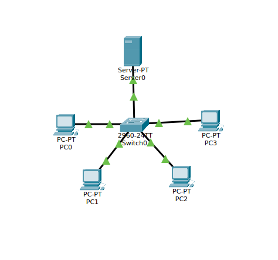

I added 4 PCs and a server from **End Devices**, plus a Cisco **2960** switch. Each device connects to the switch with a **Copper Straight-Through** cable: PCs go to Fa0/1–0/4 and the server to Fa0/5. All link lights went green, so the physical layer was up.

**Why straight-through?** A PC and a switch are *different* types of device. Their transmit and receive pins already line up, so the wire pairs don't need to cross. A crossover cable is for connecting like to like, such as switch to switch.
**Why the connections matter:** without physical links there's no network. The switch is the centre of a **star topology** and forwards frames between devices.

## 2. Static IP addressing

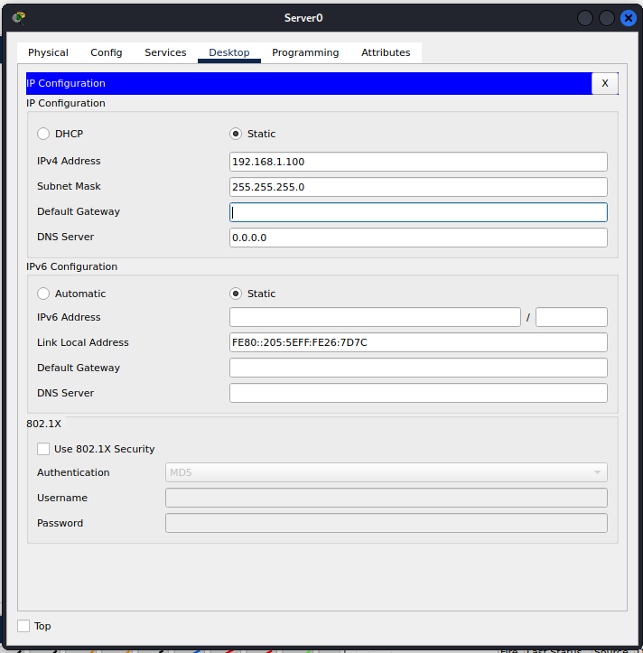

On each device: `Desktop → IP Configuration → Static`, then I entered the IP and mask from the table and left the gateway empty.

- **Why an IP address?** It's the device's unique logical address on the network, the thing other hosts use to find it and send it data.
- **What does `255.255.255.0` define?** It splits the address into network and host parts. The first 3 octets (`192.168.1`) are the network and the last octet is the host. So `.1–.254` all sit in the same subnet and can talk directly, without a router.

## 3. Connectivity test (ping)

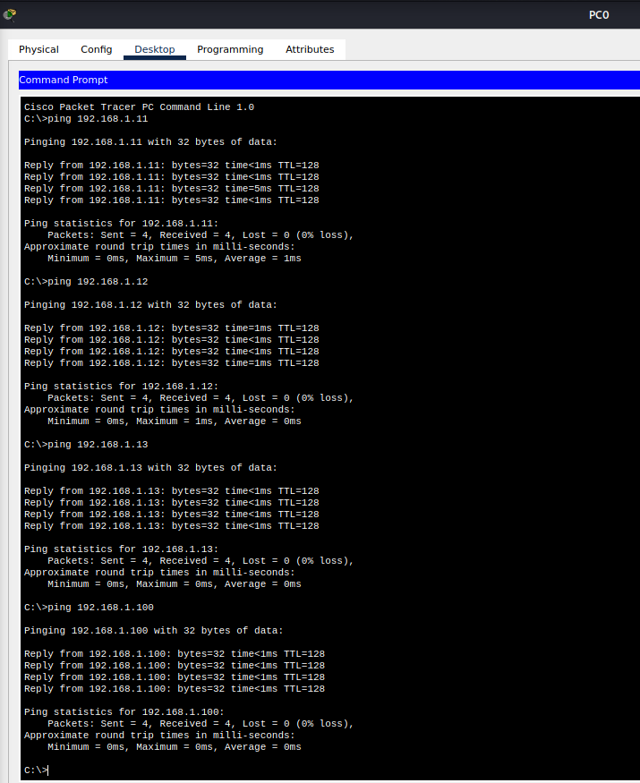

From PC0 I pinged `.11`, `.12`, `.13` and `.100`. Every ping got **4/4 replies with 0% loss** and response times under 5 ms.

None of the pings timed out, not even the first packet. My guess is that PC0 already had the MAC addresses in its ARP cache, so no ARP lookup was needed before the first echo.

- **Reply** means the target received the ICMP Echo Request and sent back an Echo Reply. The line also shows the bytes, the time and the TTL.
- **Request timed out** means no reply arrived in time. Possible causes: the host is down or unplugged, the IP or mask is wrong, there's a cable fault, or a firewall is blocking it. The *first* ping can also be lost while ARP resolves the MAC address.
- **Why ping?** It's the first troubleshooting tool to reach for. It checks reachability, round-trip time and packet loss.

## 4. Internal website (HTTP)

Server: `Services → HTTP → On`, and I edited `index.html` to say *"Welcome to Office Portal"*.
PC0: `Desktop → Web Browser → http://192.168.1.100` loaded the page.

**HTTP** (HyperText Transfer Protocol) is the protocol a browser uses to request web pages from a server and receive them.

## 5. DNS: open the site by name

| A record on the server | DNS setting on PC0 |
|---|---|
| 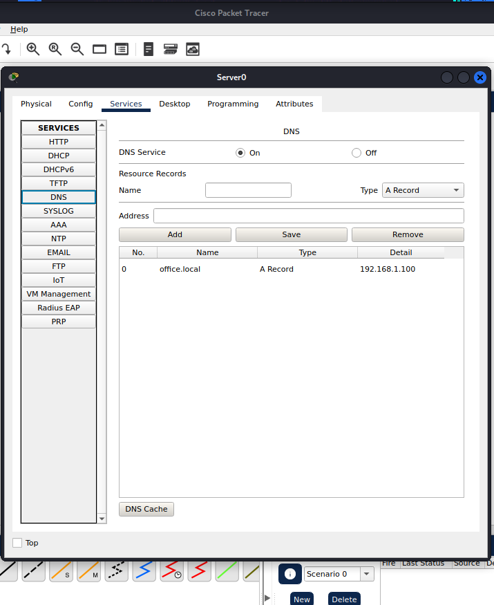 | 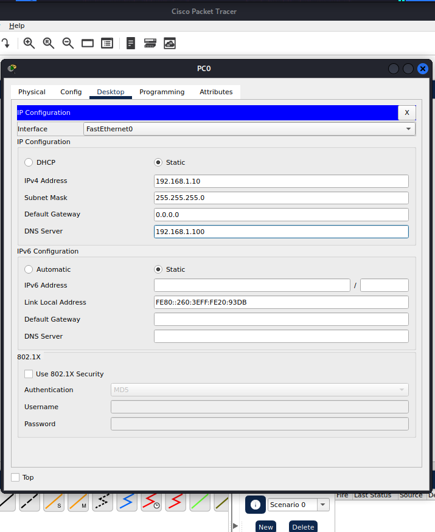 |

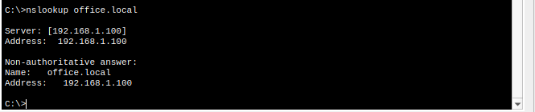

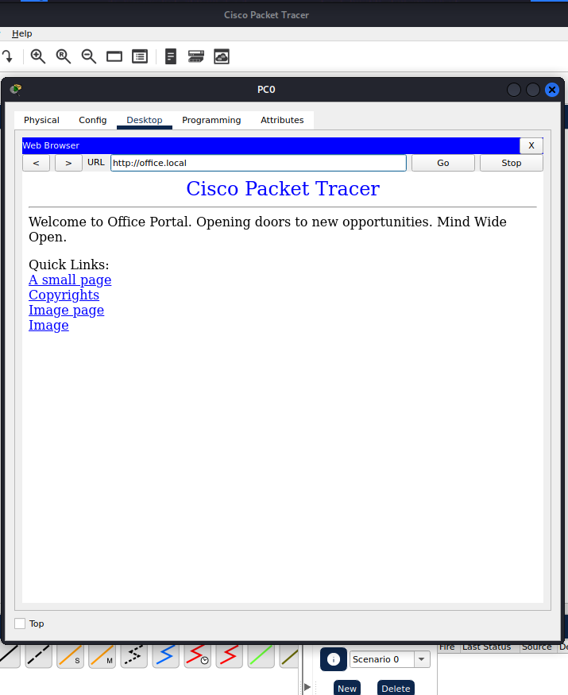

1. Server: `Services → DNS → On`, then add the **A Record** `office.local → 192.168.1.100`.
2. Every PC: set **DNS Server** to `192.168.1.100`.
3. Verify: `nslookup office.local` returns `192.168.1.100`, and `http://office.local` loads.

- **Why DNS?** It translates human-friendly names into IP addresses, like a phone book. It also means a server can change its IP and you only update one record, while users keep using the same name.
- **Without DNS** you'd have to memorize and type IPs for everything, and every IP change would break access for users until they learned the new address. The internet as we use it wouldn't really work.

---

## 6. Troubleshooting: "office.local is down"

> **Ticket:** Staff report the internal portal `office.local` won't open. Find and fix the cause.

| Step | Check | Result | Conclusion |
|---|---|---|---|
| 1 | Open `http://office.local` on PC0 | **Request Timeout** | Problem confirmed |
| 2 | Open `http://192.168.1.100` | **Page loads** | Cabling, IP and the web server are fine, so it's a **name-resolution** problem |
| 3 | Server → `Services → DNS` | DNS is On, but the A record points to **192.168.1.50** | Wrong IP. No host has `.50`, so requests go nowhere |
| 4 | Remove the bad record, keep only `office.local → 192.168.1.100` | One correct record | Fixed |
| 5 | Open `http://office.local` again | **Page loads** | Verified |

| Broken by name | Works by IP |
|---|---|
| 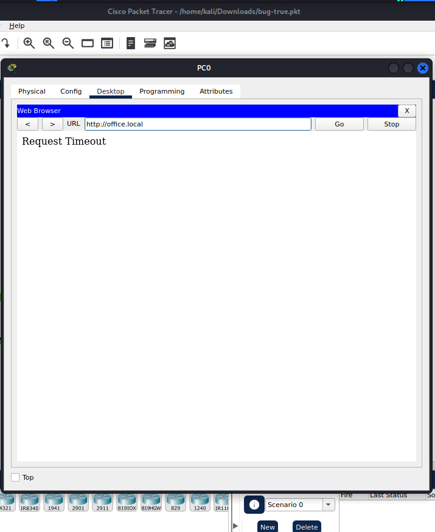 |  |

| Wrong A record (root cause) | Fixed A record |
|---|---|
| 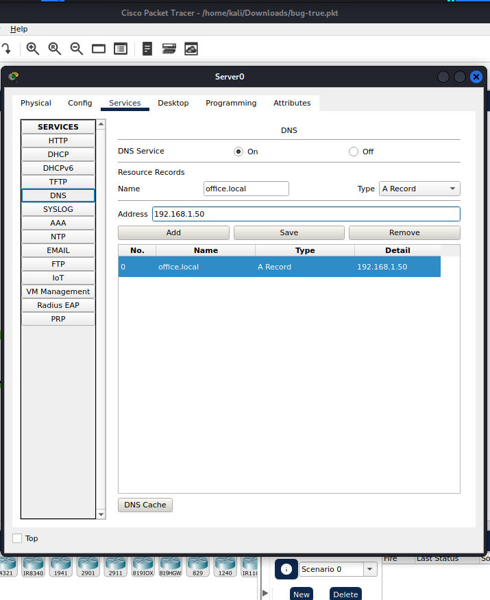 | 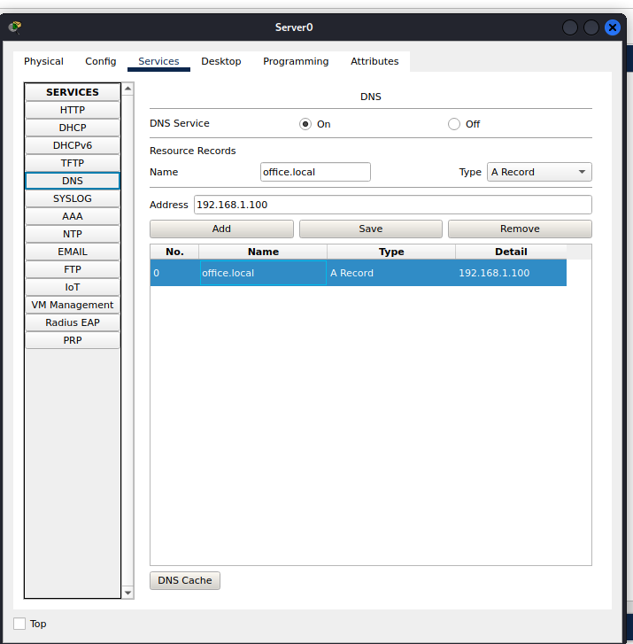 |

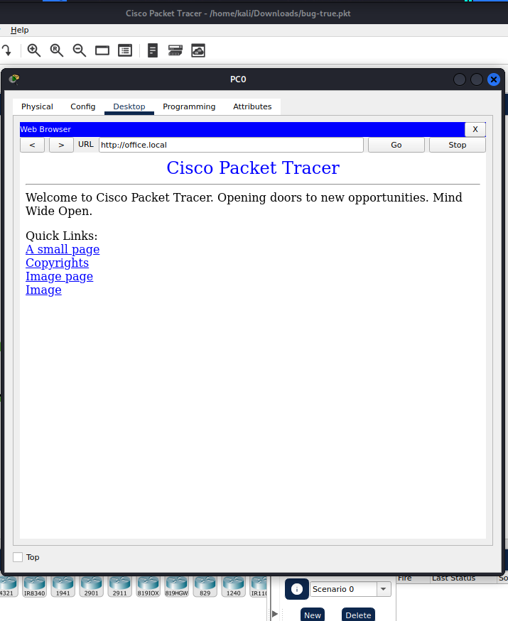

**Root cause:** the DNS A record for `office.local` pointed to the wrong IP (`192.168.1.50` instead of `192.168.1.100`).

**Mistake I caught along the way:** at first I *added* a correct record without deleting the wrong one. That left two A records for the same name. It happened to work in testing, but some clients could still be handed the bad `.50` address. The proper fix is to **replace** the record, not add a second one.

---

## Takeaways

- **Split the problem first.** If it works by IP but not by name, it's DNS. If it doesn't work by IP either, check the network or the server.
- **Change one thing at a time** and retest after each change.
- **Verify the fix**, don't assume it worked.
- **Pentest angle:** DNS is a single point that decides where users end up. Whoever controls a record (through misconfiguration, a compromised DNS server or spoofing) can silently send users to a different host. That's the idea behind DNS spoofing and cache poisoning, and it's why DNS integrity matters.
