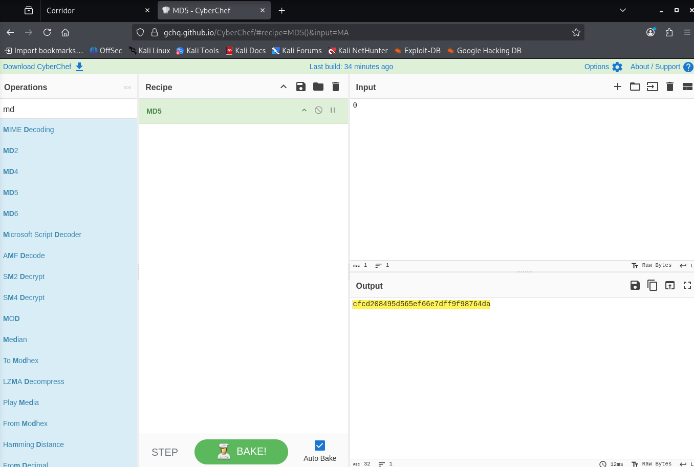
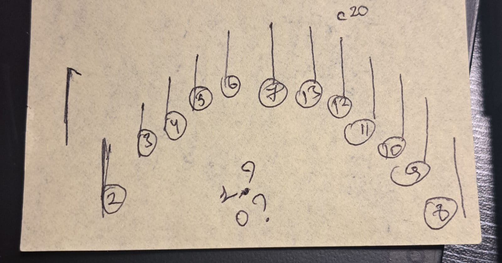
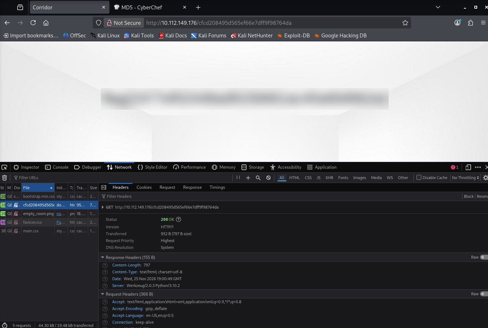

# THM – Corridor

Tools: Firefox DevTools, md5sum / CyberChef

The flag is blurred below.

## The task

You start in a corridor with a row of doors. Each door opens a page, and you have to find your way to somewhere you're not meant to go.

## What I did

Each door links to a URL with a long hex string on the end:

```
/<32 hex characters>
```

I clicked a few doors and compared the strings. They were all 32 hex characters, which is 16 bytes (128 bits). The usual thing that gives a 128-bit hex value is an MD5 hash.

So I tried hashing small numbers and comparing them to the doors. Door 1 matched `md5("1")`, door 2 matched `md5("2")`, and so on. The doors were just MD5 hashes of 1, 2, 3, ... up to 13.

I wrote the door numbers out on paper to see the pattern. The corridor showed doors 1 through 13, but there was no door for **0**. So I hashed `0` myself:

```
echo -n 0 | md5sum
# cfcd208495d565ef66e7dff9f98764da
```



Then I put that hash in the URL by hand, visited the "door" the corridor never offered, and the flag was behind it.





## Why this works

This is the same bug as Neighbour: an IDOR. The page serves whatever the hash in the URL points to and never checks whether you're allowed to open that door. Hashing the values only hides the pattern; it isn't access control. Once you see the doors are `md5(n)`, you can request any `n` you want, including ones the site never links to (forced browsing).

The fix is to check on the server that the logged-in user is allowed to open the door they asked for, instead of trusting the URL.

## Notes for myself

- 32 hex chars = MD5. Count the length first, then you know what you're looking at.
- If a site hides pages behind hashes or IDs, look for the gap in the sequence. The interesting page is often the one that isn't linked.
- "Obscuring" an ID (hashing, encoding) is not the same as protecting it.
