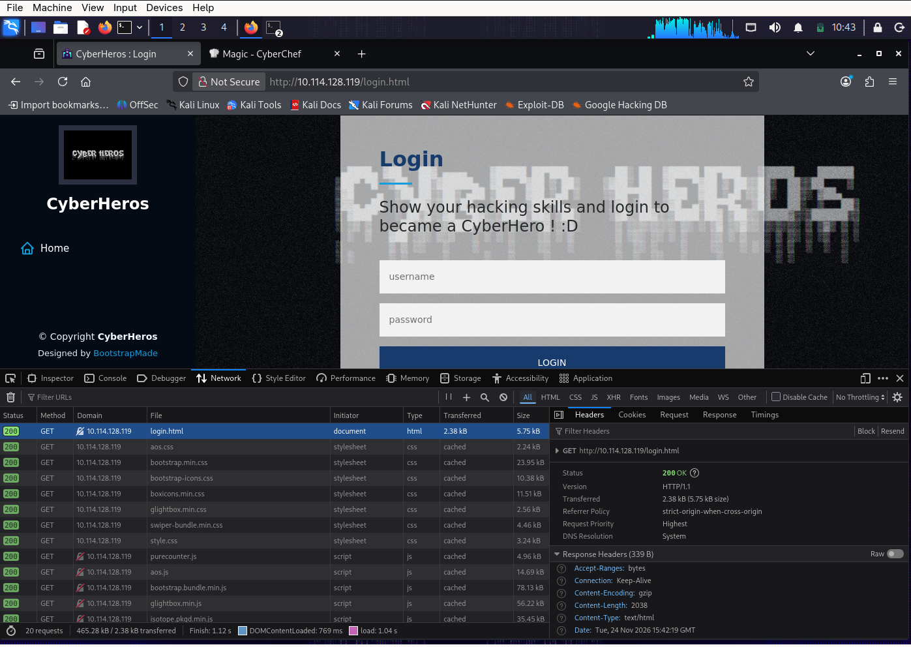
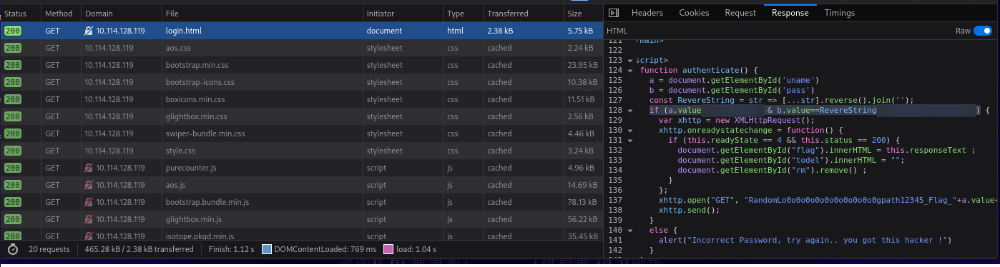
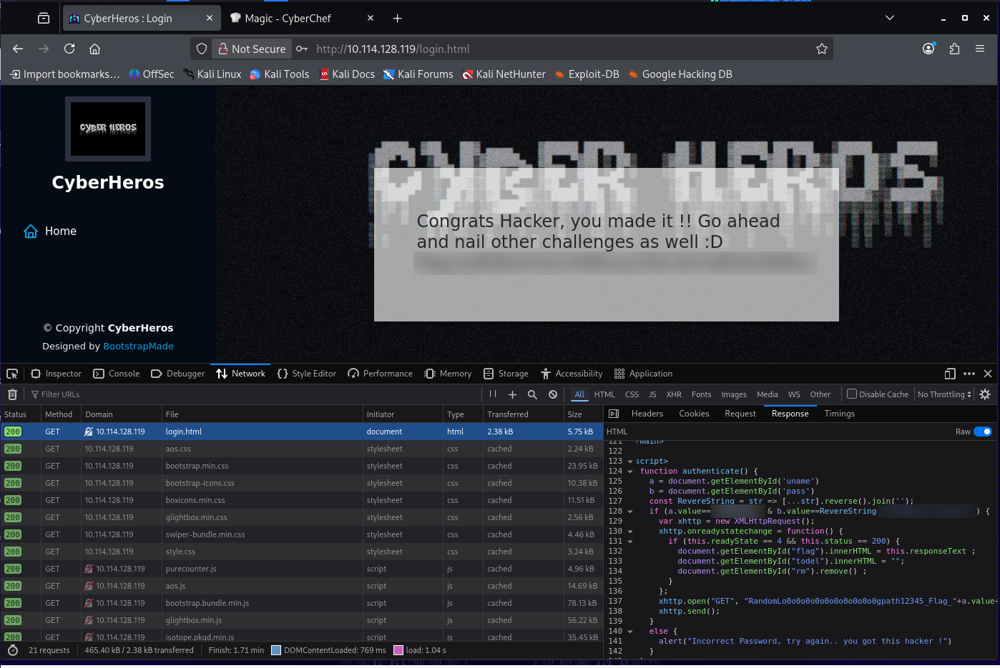

# THM – CyberHeroes

Tools: Firefox DevTools

Flag and credentials are blurred/redacted below.

## The task

There's a login page and you need to get past it to get the flag. That's the whole room.

## What I did

I opened the login page (`/login.html`) and opened DevTools on the Network tab, then reloaded the page.



I clicked on the `login.html` request and looked at the Response. At the bottom of the HTML there's a script with an `authenticate()` function, and the username and password are just sitting there in it:

```javascript
if (a.value=="<REDACTED>" & b.value==RevereString("<REDACTED>")) {
```

The only "protection" is that the password is written backwards and `RevereString()` flips it before comparing. If the check passes, the page requests a file named `RandomLo0o0o0...gpath12345_Flag_` plus the username and password, and shows what's in it.



The password was short, so I just reversed it in my head and typed it in. Logged in with the username and the reversed password and got the flag.



## Why this works

The login is checked in JavaScript, in the browser. The server doesn't check anything, so anyone who opens the source gets the credentials. Writing the password backwards doesn't change that. You could also skip the login completely and request the flag file directly, since its name is built from values that are in the source too.

The fix is to check the login on the server and store passwords hashed, not in the page.

## Notes for myself

- Check the source before trying to guess passwords. That was enough here.
- If the login check is in client-side JS, the answer is probably in the source.
