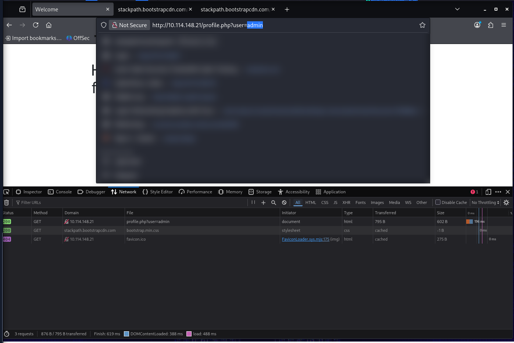
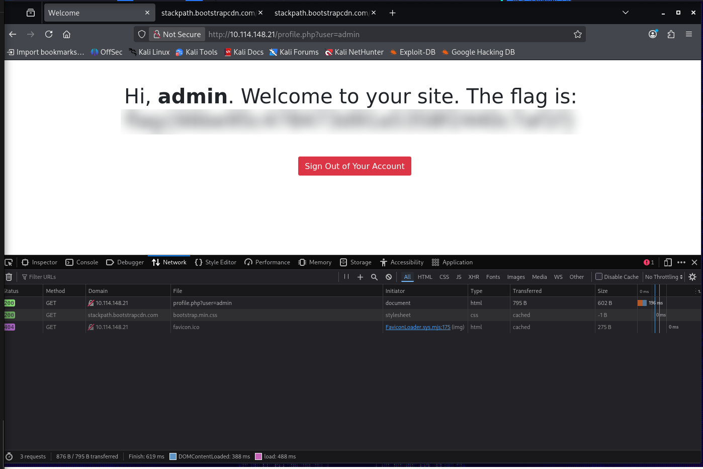

# THM – Neighbour

Tools: Firefox DevTools

The flag is blurred/redacted below.

## The task

A "cloud service" with a login page. The goal is to find another user's secrets, and the admin's is the one you want.

## What I did

I checked the login page's source first, since that's what solved CyberHeroes. It has a comment saying you can log in with a guest account, so I did.

After logging in, the page sent me to:

```
/profile.php?user=guest
```

The username is right there in the URL. So I changed `guest` to `admin` and reloaded.



That loaded the admin's page with the flag. No password needed.



## Why this works

This is an IDOR (Insecure Direct Object Reference). The server shows whichever profile is named in the `user` parameter. It doesn't check if the logged-in user is allowed to see that profile. Logging in only proves who you are, but the page never asks whether you should see what you asked for.

The fix is to take the user from the session on the server side, not from the URL, and check permissions on every request.

## Notes for myself

- Look for IDs or usernames in URLs and try changing them.
- Being logged in (authentication) and being allowed (authorization) are different checks. This site only did the first one.
